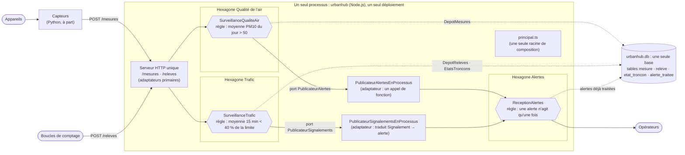
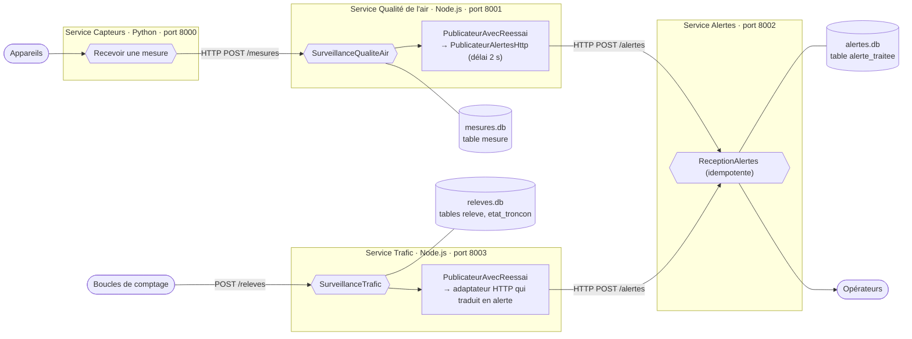

# TP 3, étape 2 : UrbanHub dessiné deux fois, en monolithe hexagonal puis en microservices

**Consigne :** dessiner UrbanHub en monolithe hexagonal, puis en microservices (un contexte par
service, chacun sa base).

**Point de départ :** les quatre contextes de l'[étape 1](etape1-contextes-delimites.md) :
Qualité de l'air, Trafic, Alertes, et Capteurs (le service Python du cours).

Les deux dessins gardent **les mêmes hexagones**. Ce qui change, c'est seulement :
- le nombre de processus ;
- le nombre de bases ;
- les adaptateurs qui relient les hexagones.

Les schémas sont en Mermaid : GitHub les affiche directement.

---

## 1. UrbanHub en monolithe hexagonal

**Un seul programme Node.js, une seule base, trois hexagones.** Capteurs reste à part, parce qu'il
est écrit en Python.

### Ce qu'on lit

| Élément | Dans le monolithe |
|---|---|
| **Processus** | un seul : un serveur HTTP reçoit `/mesures` et `/releves` |
| **Appels entre hexagones** | des **appels de fonction**. Qualité de l'air appelle toujours son port `PublicateurAlertes`, mais l'adaptateur derrière n'est plus HTTP : il appelle directement `ReceptionAlertes.recevoir()` |
| **Base** | **une seule** (`urbanhub.db`), avec une table (ou un groupe de tables) par hexagone |
| **Règle qui garde les hexagones séparés** | un hexagone ne lit **jamais** la table d'un autre. Il passe par le port de l'autre. Sinon, on ne pourra plus jamais découper |
| **Racine de composition** | **une seule** `principal.ts`, qui crée les trois hexagones et les branche entre eux |
| **Déploiement** | un seul : livrer Trafic redéploie aussi l'air et les alertes |

### Ce que le monolithe ne change pas

- Les **domaines**, les **ports**, les **cas d'utilisation** et les **règles** sont exactement ceux
  du code actuel : aucune ligne du centre ne bouge.
- Les tests du centre et les tests de contrat (67 aujourd'hui) restent valables. Ils n'ont jamais
  dépendu de HTTP ni d'un fichier de base précis.
- Seuls les **adaptateurs** et la **racine de composition** sont différents :

| Adaptateur | Aujourd'hui | Dans le monolithe |
|---|---|---|
| Publication Air → Alertes | `PublicateurAlertesHttp` + réessai | un appel de fonction (plus de réseau, donc plus de réessai) |
| Publication Trafic → Alertes | `PublicateurSignalementsHttp` vers le port 8004, où personne n'écoute | un adaptateur qui **traduit** le `Signalement` en alerte pour Alertes |
| Dépôts SQLite | un fichier par service | un seul fichier, une table par hexagone |

### Ce qui reste un piège

Le dessin montre **une** base. La tentation sera d'écrire une requête SQL qui croise `mesure` et
`releve`, par exemple « la pollution quand le trafic est bloqué ». Une telle jointure soude les
deux hexagones, et le découpage de l'étape suivante deviendrait impossible sans réécriture.

Si ce besoin arrive, on l'écrit comme un **cas d'utilisation de plus**, qui interroge les deux
ports. Jamais comme une jointure.

---

## 2. UrbanHub en microservices

**Un contexte par service, chacun avec sa base, et des appels HTTP entre eux.**

### Ce qu'on lit

| Élément | En microservices |
|---|---|
| **Processus** | quatre : Capteurs (8000), Qualité de l'air (8001), Alertes (8002), Trafic (8003). Ce sont les ports que le code utilise déjà |
| **Appels entre services** | des **appels réseau** HTTP. Chacun a un délai (2 s) et un réessai (Décorateur), et le récepteur est idempotent |
| **Bases** | **une par service**, que personne d'autre n'ouvre : `mesures.db`, `releves.db`, et une nouvelle `alertes.db` |
| **Racines de composition** | une par service : les `principal.ts` actuels |
| **Déploiement** | un par service : livrer Trafic ne touche ni à l'air ni aux alertes |

### Ce qu'il faut ajouter au code actuel pour arriver à ce dessin

Le code du dépôt est déjà presque dans cette forme : trois dossiers, trois `principal.ts`, deux
bases séparées. Il manque deux choses, que l'étape 1 avait repérées :

1. **Alertes a besoin de sa base.**
   - Aujourd'hui, les identifiants déjà traités sont dans un `Set` en mémoire.
   - En microservice, Alertes redémarre seul (mise à jour, panne). À chaque redémarrage, il
     oublierait ce qu'il a déjà traité, et un réessai de Qualité de l'air préviendrait les
     opérateurs deux fois.
   - D'où `alertes.db`, avec une table `alerte_traitee` dont la clé est l'identifiant. C'est le
     même remplacement d'adaptateur qu'à l'étape 6 du TP 2, pour les états des tronçons.
2. **Trafic a besoin d'un destinataire.**
   - Il faut pointer `URL_SIGNALEMENTS` sur `http://alertes:8002/alertes`.
   - Il faut aussi un adaptateur qui traduit le `Signalement` dans le contrat d'Alertes : un
     `identifiant` et un texte à afficher.
   - La traduction se fait **côté Trafic**, dans un adaptateur. Alertes n'apprend rien du
     vocabulaire du trafic.

---

## 3. Les deux dessins, côte à côte

| | Monolithe hexagonal | Microservices |
|---|---|---|
| Processus | 1 (plus Capteurs en Python) | 4 |
| Bases | 1 (`urbanhub.db`), une table par hexagone | 3 (`mesures.db`, `releves.db`, `alertes.db`) |
| Air → Alertes | appel de fonction, par le port `PublicateurAlertes` | `POST /alertes` avec délai et réessai, par **le même port** |
| Trafic → Alertes | appel de fonction, avec traduction | `POST /alertes` avec traduction, délai et réessai |
| Racines de composition | 1 | 1 par service |
| Centre (domaine, ports, règles) | **inchangé** | **inchangé** |
| Ce qui diffère | les adaptateurs entre hexagones, la racine | les adaptateurs entre hexagones, les racines |

**Ce que montre ce tableau :** on passe d'un dessin à l'autre **en changeant des adaptateurs et des
racines de composition**, jamais le centre. C'est la phrase du cours (slide 59) : « un monolithe
bien découpé en hexagones se découpe ensuite en services sans réécrire la logique métier ».

L'étape 3 compare ces deux dessins sur cinq critères : appels, transactions, déploiement, montée
en charge et panne.
