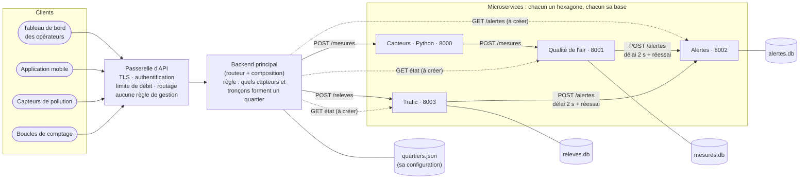

# TP 3, étape 4 : la vue d'ensemble, et la gestion de chaque service

**Consigne :**
- dessiner la vue d'ensemble : passerelle, backend principal, services et bases ;
- écrire qui appelle qui, et pourquoi ;
- noter, pour chaque service, sa configuration par environnement, sa supervision et sa livraison.

**Point de départ :** le dessin B (microservices) de l'[étape 2](etape2-deux-dessins.md).

**Ce qui existe déjà et ce que nous proposons :** chaque tableau distingue ce qui **existe déjà**
dans le code et ce que nous **proposons**. Une vue d'ensemble qui promet des routes qui n'existent
pas serait un argument de vente, pas une architecture.

---

## 1. Le schéma

- **Les flèches pleines** existent déjà dans le code (ou dans le code du cours, pour Capteurs).
- **Les flèches pointillées** sont à créer.

---

## 2. Qui appelle qui, et pourquoi

| De | Vers | Appel | Pourquoi cet appel, et pas un autre | Existe ? |
|---|---|---|---|---|
| Tous les clients | **Passerelle** | HTTPS | **Le seul point d'entrée.** On authentifie et on limite le débit à un seul endroit. Un capteur détourné qui envoie 1 000 mesures par seconde est arrêté avant d'atteindre un service | à installer (un produit, pas du code : Kong, Traefik, nginx…) |
| Passerelle | **Backend principal** | HTTP interne | La passerelle **aiguille sans comprendre**. Elle n'a aucune règle de gestion (slide 68) | à créer |
| Backend principal | Capteurs | `POST /mesures` | Une mesure d'appareil doit d'abord être reçue et validée par Capteurs, qui la transmet | Capteurs : code du cours |
| Capteurs | Qualité de l'air | `POST /mesures` | Qualité de l'air possède la règle PM10. C'est lui qui décide s'il faut alerter | **oui** ([`entreeHttp.ts`](https://github.com/Ibrxhxm-Bxddxne/cours-hexagonale/blob/079855e5092161ed93a7fc16c2486d844d591ab4/urbanhub-air/src/adaptateurs/entreeHttp.ts)) |
| Backend principal | Trafic | `POST /releves` | Trafic possède la règle de congestion | **oui** ([`entreeHttp.ts`](https://github.com/Ibrxhxm-Bxddxne/cours-hexagonale/blob/079855e5092161ed93a7fc16c2486d844d591ab4/urbanhub-trafic/src/adaptateurs/entreeHttp.ts)) |
| Backend principal | Air **et** Trafic | `GET` d'état | **La composition.** Le tableau de bord demande « l'état du quartier Voltaire ». Le backend principal sait quels capteurs et quels tronçons forment ce quartier, appelle les deux services **en parallèle** et rend une seule réponse | **à créer** : ni Air ni Trafic n'ont de route de lecture |
| Backend principal | Alertes | `GET /alertes` | L'écran des opérateurs liste les alertes du jour | **à créer** (il faut d'abord la base d'Alertes) |
| Qualité de l'air | Alertes | `POST /alertes` | Une alerte est une **conséquence** d'une mesure, pas une demande d'un client | **oui**, avec réessai ([`publicationHttp.ts`](https://github.com/Ibrxhxm-Bxddxne/cours-hexagonale/blob/079855e5092161ed93a7fc16c2486d844d591ab4/urbanhub-air/src/adaptateurs/publicationHttp.ts)) |
| Trafic | Alertes | `POST /alertes` | Un bouchon doit lui aussi prévenir les opérateurs | **en partie** : il publie vers le port 8004, sans traduction (étape 1, § 4) |

### Pourquoi Air et Trafic appellent Alertes directement, sans passer par le backend principal

Le backend principal sert les **clients**. Une alerte ne vient pas d'un client : elle naît **dans**
un service, à la suite d'une mesure.

La faire remonter par le backend principal poserait deux problèmes :
- elle ajouterait un saut réseau ;
- le backend principal deviendrait un point de passage obligé pour des messages qu'il ne comprend
  pas.

Ces appels internes restent donc **à l'intérieur du cluster** et ne sont pas exposés par la
passerelle. Au TP 4, ils passeront par le journal Kafka.

### La règle que porte le backend principal, et celle qu'il ne porte pas

| Il porte | Il ne porte pas |
|---|---|
| quels capteurs et quels tronçons forment un quartier (`quartiers.json`) | le seuil PM10 : c'est Qualité de l'air |
| dans quel ordre appeler, et comment composer les réponses | le seuil de congestion : c'est Trafic |
| quoi rendre si l'un des deux services ne répond pas dans le délai : une réponse **partielle**, avec un champ `indisponible: ["trafic"]`, plutôt qu'une erreur 500 | le dédoublonnage : c'est Alertes |

Le backend principal est lui aussi un petit hexagone :
- un port primaire, `EtatDuQuartier` ;
- deux ports secondaires, `LireQualiteAir` et `LireTrafic`, avec chacun un adaptateur HTTP muni
  d'un délai.

Son test tourne sans réseau, avec deux faux adaptateurs.

---

## 3. La gestion de chaque service

Les trois environnements sont ceux du cours :
- **dev** : le poste du développeur, `npm run …` ;
- **recette** : `docker compose up`, pour valider avant la production ;
- **production** : Kubernetes.

### 3.1 Configuration par environnement

Toute la configuration passe par des **variables d'environnement**, lues **seulement** dans les
racines de composition (`principal.ts`). Le code ne contient aucune adresse ni aucun secret.

**Qualité de l'air**

| Variable | dev | recette | production | Existe ? |
|---|---|---|---|---|
| `PORT` | 8001 | 8001 | 8001 | oui |
| `BASE_MESURES` | `mesures.db` | `/donnees/mesures.db` (volume) | adresse PostgreSQL, depuis un **Secret** (étape 3, § 3) | oui (SQLite) |
| `URL_ALERTES` | `http://localhost:8002/alertes` | `http://alertes:8002/alertes` | `http://alertes:8002/alertes` (Service Kubernetes) | oui |

**Trafic**

| Variable | dev | recette | production | Existe ? |
|---|---|---|---|---|
| `PORT` | 8003 | 8003 | 8003 | oui |
| `BASE_RELEVES` | `releves.db` | `/donnees/releves.db` | adresse PostgreSQL (Secret) | oui (SQLite) |
| `TRONCONS` | `troncons.json` du dépôt | fichier monté | **ConfigMap** | oui |
| `URL_SIGNALEMENTS` | `http://localhost:8002/alertes` | `http://alertes:8002/alertes` | `http://alertes:8002/alertes` | oui, mais le défaut actuel (8004) vise un service qui n'existe pas |
| `REGLE` | `avec-minimum` | `avec-minimum` | `avec-minimum` (pas de faux bouchon la nuit, TP 2, étape 5) | oui |

**Alertes**

| Variable | dev | recette | production | Existe ? |
|---|---|---|---|---|
| `PORT` | 8002 | 8002 | 8002 | oui |
| `BASE_ALERTES` | `alertes.db` | `/donnees/alertes.db` | adresse PostgreSQL (Secret) | **à créer** (étape 2) |

**Backend principal**

| Variable | dev | recette | production | Existe ? |
|---|---|---|---|---|
| `URL_AIR`, `URL_TRAFIC`, `URL_ALERTES` | `localhost:…` | noms des conteneurs | noms des Services Kubernetes | à créer |
| `QUARTIERS` | `quartiers.json` | fichier monté | ConfigMap | à créer |
| `DELAI_MS` | 2000 | 1000 | 1000 : un écran attend moins qu'un capteur | à créer |

**Capteurs (cours, Python)** : l'URL de Qualité de l'air, et le délai de 2 s (`delai_s`, slide 44).

### 3.2 Supervision

Pour chaque service : ce qu'il produit déjà, ce qu'il faut ajouter, et le signal qui doit réveiller
quelqu'un. Nous reprenons les trois signaux du cours (slide 75) : journaux, métriques et traces.

| Service | Ce qu'il produit **déjà** | À ajouter | Le signal d'alarme |
|---|---|---|---|
| Qualité de l'air | Il journalise toute erreur 500 (`console.error`). Les mesures invalides reçoivent 422, sans bruit | `GET /sante` (la base répond-elle ?) ; compteurs : mesures reçues, 422, 500, essais de publication, durée de publication | **taux de 500 > 1 %** : Alertes est probablement en panne (étape 3 : 1,5 s puis 500) ; **durée de publication > 2 s** : Alertes est figé |
| Trafic | Il journalise les 500. Un tronçon inconnu reçoit 404, une donnée invalide 422 | `GET /sante` ; compteurs : relevés, 404 par tronçon, signalements, tronçons congestionnés | **beaucoup de 404 sur un tronçon** : `troncons.json` n'est pas à jour ; **aucun relevé depuis 5 min** : les boucles ne parlent plus |
| Alertes | Il journalise `recu <identifiant>` pour chaque alerte | `GET /sante` ; compteurs : alertes reçues, **doublons ignorés**, opérateurs prévenus | **doublons > 10 % des alertes** : un émetteur réessaie trop, signe d'une panne réseau en amont |
| Backend principal | — | durée de chaque appel ; nombre de réponses **partielles** | **réponses partielles en hausse** : l'un des services est lent |
| Passerelle | ses propres journaux d'accès | — | **429 (débit dépassé) sur un même capteur** : appareil défaillant ou détourné |

**Une trace, de bout en bout.** La passerelle crée un en-tête `X-Correlation-Id`. Chaque service :
- le lit dans son adaptateur primaire ;
- le recopie dans ses journaux ;
- le transmet dans ses adaptateurs secondaires.

Ainsi, une alerte reçue par Alertes se relie à la mesure qui l'a déclenchée. Ce travail ne touche
**que les adaptateurs** : le centre ne connaît pas HTTP, il ne connaîtra pas cet en-tête non plus.

Outils proposés : journaux dans Loki, métriques dans Prometheus et Grafana, traces avec
OpenTelemetry (slide 75).

### 3.3 Livraison

| Service | Tests qui doivent passer avant de livrer | Image | Existe ? |
|---|---|---|---|
| Qualité de l'air | `surveillance`, `contratDepot`, `regleDependance`, `reessai`, `entreeCsv`, `publicationKafka`, `avant`, `experience1`, `experience3`, **et `boutEnBout`** | `urbanhub/qualite-air:<version>` | **oui** ([`Dockerfile`](https://github.com/Ibrxhxm-Bxddxne/cours-hexagonale/blob/079855e5092161ed93a7fc16c2486d844d591ab4/Dockerfile)) |
| Trafic | `trafic`, `contratDepotReleves`, `contratEtatsTroncons`, `patronsTrafic`, `regleDependanceTrafic` | `urbanhub/trafic:<version>` | tests oui ; **Dockerfile à créer** |
| Alertes | `alertesIdempotent`, **et `boutEnBout`** | `urbanhub/alertes:<version>` | tests oui ; **Dockerfile à créer** (en recette, il tourne dans une image `node` générique) |
| Backend principal | son test en mémoire, et un test de la réponse partielle | `urbanhub/principal:<version>` | à créer |
| Capteurs | `pytest` (cours) | `urbanhub/capteurs:<version>` | code du cours |

**La chaîne de livraison de chaque service :**
1. `npm test` sur **ses** tests ;
2. construction de l'image ;
3. étiquette = l'empreinte du commit ;
4. envoi au registre d'images ;
5. `kubectl apply` de **son** manifeste.

La stratégie de déploiement (progressive, bleu-vert ou canari) est choisie à l'étape 5.

**Pourquoi `boutEnBout` est dans deux chaînes.** C'est le seul test qui vérifie le **contrat** entre
Qualité de l'air et Alertes : le format du message et le code 202. Si l'un des deux services le
change, les deux chaînes doivent échouer, pas seulement celle qui a fait le changement.

**Ce que la livraison séparée demande encore.** Aujourd'hui, le dépôt a **un seul `package.json`**
et un seul `npm test`, qui lance les 67 tests. Pour livrer chaque service seul, il faut :
- un script de test par service, par exemple `npm run test:trafic` ;
- un Dockerfile par service.

Le code du centre, lui, ne bouge pas.

---

## Résumé : ce qui reste à construire pour que ce schéma soit vrai

| À créer | Pour | Touche le centre ? |
|---|---|---|
| Passerelle (configuration d'un produit) | entrée unique, authentification, débit | non |
| Backend principal (un petit hexagone) | composer l'état d'un quartier | non : c'est un nouveau service |
| Routes `GET` d'état dans Air et Trafic | la composition | **oui** : un cas d'utilisation de lecture et un port de plus dans chaque service |
| Base et `GET /alertes` dans Alertes | survivre aux redémarrages ; lister les alertes | un adaptateur ; un cas d'utilisation de lecture |
| Traduction Signalement → alerte dans Trafic | que les bouchons arrivent chez les opérateurs | non : un adaptateur |
| `GET /sante`, compteurs, `X-Correlation-Id` | la supervision | non : des adaptateurs |
| Dockerfile et script de test par service | la livraison séparée | non |

Une seule ligne touche un centre : ajouter un cas d'utilisation de **lecture**. Tout le reste se
fait en **adaptateurs** et en **configuration**.
